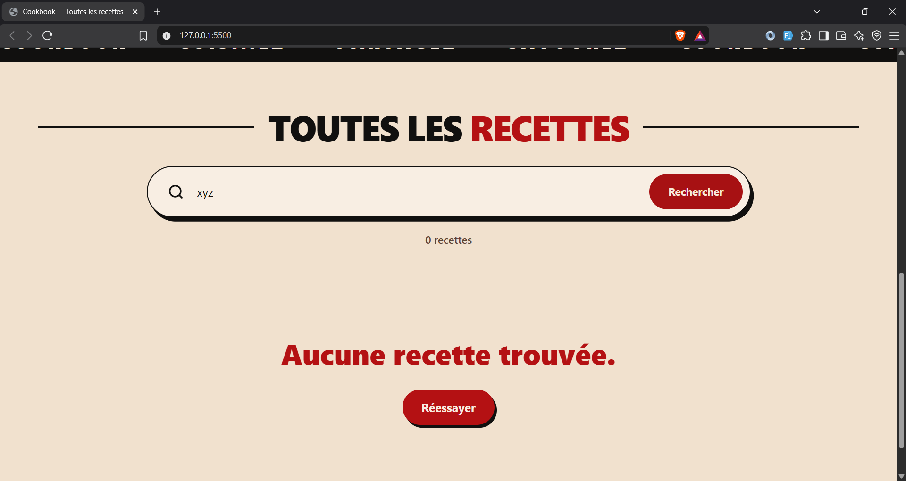
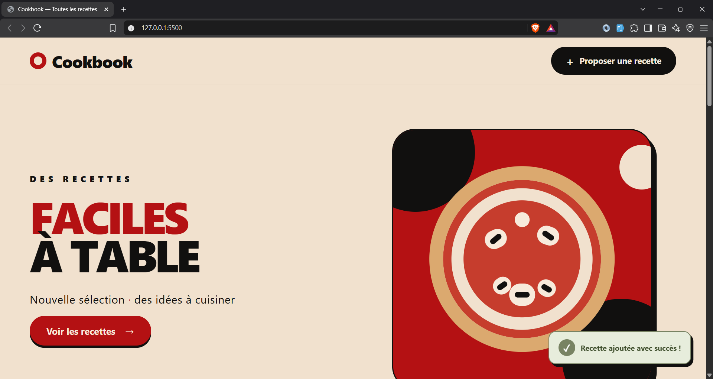
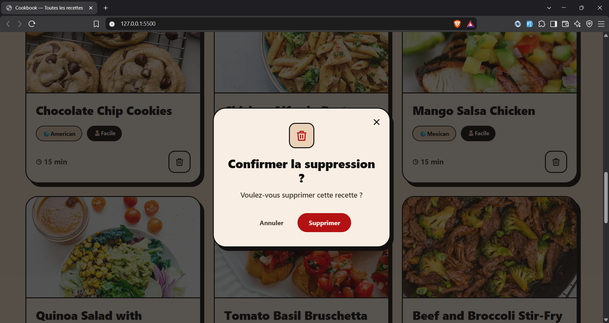
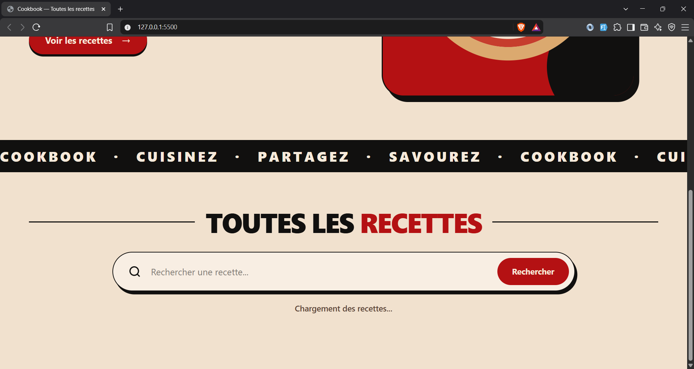
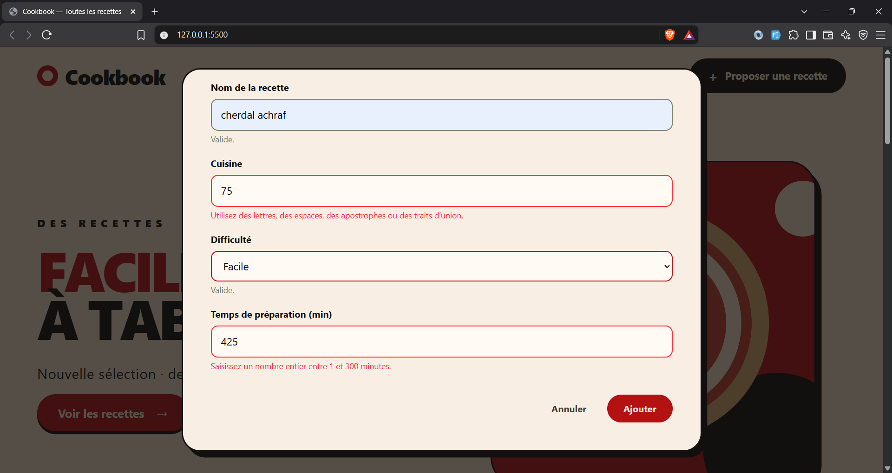

# Cookbook — Axios in the Kitchen

A small recipe browser built with HTML, Tailwind CSS, JavaScript modules, and Axios. It lets visitors browse and search recipes, submit a recipe, and remove a recipe from the displayed list.

## Run locally

The page uses JavaScript modules, so serve the project over HTTP instead of opening `index.html` directly.

1. Install the project dependency if needed:

   ```bash
   npm install
   ```

2. Start a local static server from the project root. For example, with Python:

   ```bash
   python -m http.server 5500
   ```

3. Open [http://127.0.0.1:5500](http://127.0.0.1:5500) in a browser. VS Code Live Server on port 5500 also works.

## Features

- Load and display up to 12 recipes.
- Search recipes by text and show an empty-results state.
- Add recipes through a validated form.
- Confirm before deleting a recipe.
- Show French loading, validation, success, and error messages.

## Project files

| File | Responsibility |
| --- | --- |
| `index.html` | Page structure, styling setup, and JavaScript entry point. |
| `js/main.js` | UI events, loading/search/add/delete flows, and user-facing request error handling. |
| `js/apicalls.js` | Axios instance and functions for the recipe API requests. |
| `js/display.js` | Recipe cards, form, confirmation modal, error state, and success notice. |
| `js/validation.js` | Form field rules and inline validation feedback. |

## API request reference

All requests use `https://dummyjson.com` through the Axios instance in `js/apicalls.js`.

| Action | Method and URL | Sent data | Response used by the app |
| --- | --- | --- | --- |
| Load recipes | `GET /recipes?limit=12` | Query parameter `limit=12` | `data.recipes` array |
| Search recipes | `GET /recipes/search?limit=12&q={search}` | Search text in `q` | `data.recipes` array; an empty array means no matches |
| Add recipe | `POST /recipes/add` | JSON with `name`, `cuisine`, `difficulty`, and `prepTimeMinutes` | The API returns a created recipe and ID; the UI currently adds its submitted object to the local list |
| Delete recipe | `DELETE /recipes/{id}` | Recipe ID in the URL | HTTP success status; the UI removes the recipe locally |

### Demo API limitation

DummyJSON is a demo API. Its add and delete endpoints simulate the request and return a response, but do not persist changes on the server. A page reload restores the server's original recipe data. See the [DummyJSON Recipes documentation](https://dummyjson.com/docs/recipes).

## Error behavior

- Axios rejects non-2xx responses. The request caller should inspect `error.response?.status` for an HTTP error.
- If there is no `error.response`, the request failed before receiving an HTTP response (for example, offline or a timeout).
- Expected UI messages distinguish missing resources (`404`), rate limits (`429`), server failures (`5xx`), and connection failures.
- DummyJSON has a mock HTTP endpoint for checking status responses, such as [`/http/500`](https://dummyjson.com/http/500); it is useful for testing error handling without changing the recipe data.

## Verification

The following checks were run while preparing this README:

| Check | Result |
| --- | --- |
| `node --check` for `main.js`, `apicalls.js`, `display.js`, and `validation.js` | Passed |
| Local page server at `127.0.0.1:5500` | HTTP 200 |
| Load recipes (`GET /recipes?limit=12`) | HTTP 200; 12 recipes returned |
| Search for `Margherita` | HTTP 200; matching results returned |
| Search for a nonexistent term | HTTP 200; zero results returned |
| Add test recipe | HTTP 201; returned an ID (simulated, not persisted) |
| Delete recipe `1` | HTTP 200; response reported `isDeleted: true` (simulated, not persisted) |
| Request nonexistent recipe `999999` | HTTP 404 |
| DummyJSON mock HTTP 500 endpoint | HTTP 500 |

These API checks verify the server responses, but they do not exercise every interaction in the browser. Complete this manual UI checklist before presenting the app:

1. Load the page and confirm the loading text changes to the recipe count and cards.
2. Search for a known recipe and confirm matching cards display.
3. Search for a term with no matches and confirm the empty-results state and retry control display.
4. Submit an invalid recipe and confirm validation blocks the POST request.
5. Submit a valid recipe and confirm the card and count update.
6. Delete a recipe and confirm the modal, list, and count update.
7. Set DevTools Network to **Offline**, search again, and confirm the loading state is replaced by an error. Restore **No throttling** afterward.
8. Exercise `404` and `500` UI messages against a mock response; direct API status checks alone do not verify the UI message.

## Screenshots

Add the screenshots to the `screenshots/` folder with the matching filenames below to display them in this gallery.

### Undifined search results



### Recipe list and add-success notice



### Delete confirmation



### Loading state



### Form validation errors



## Notes

- Tailwind CSS is loaded from its browser CDN in `index.html`.
- The browser loads the vendored Axios bundle from `js/vendor/axios.min.js`, so the static deployment does not depend on a CDN or publish `node_modules`.
- There is no automated test script configured in `package.json` yet.
